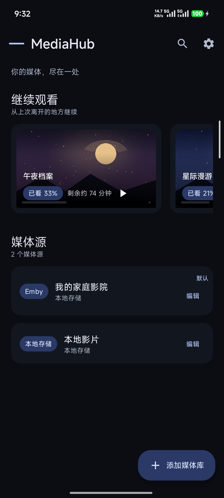
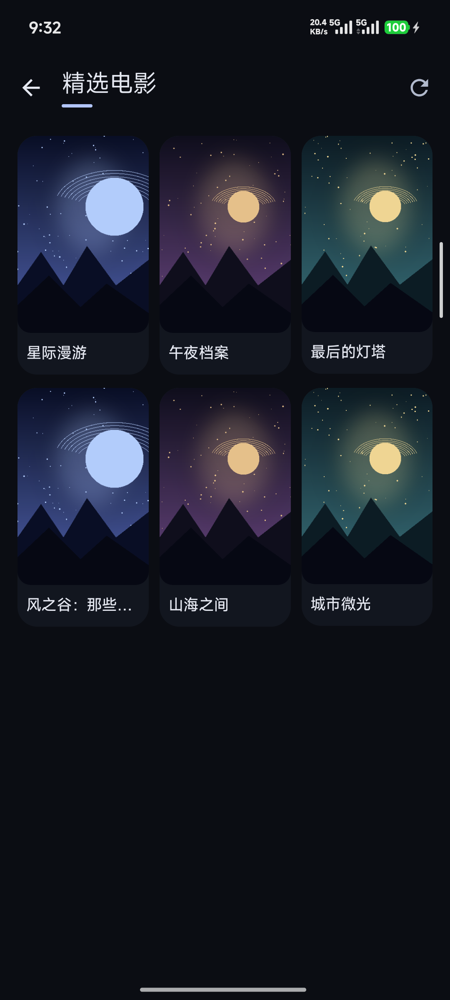
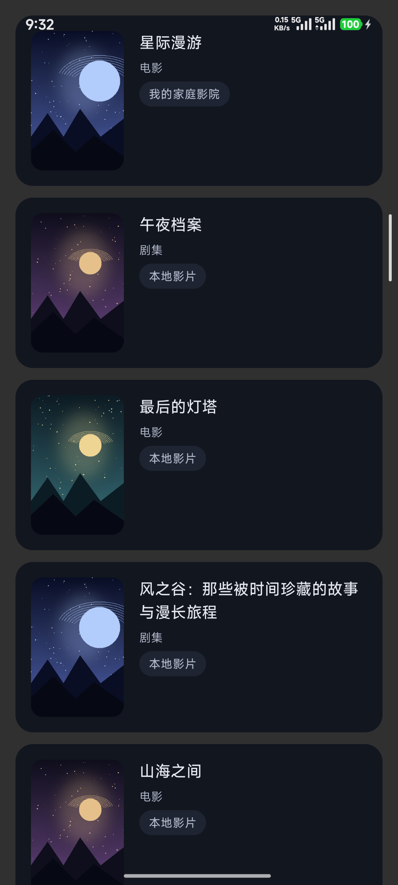
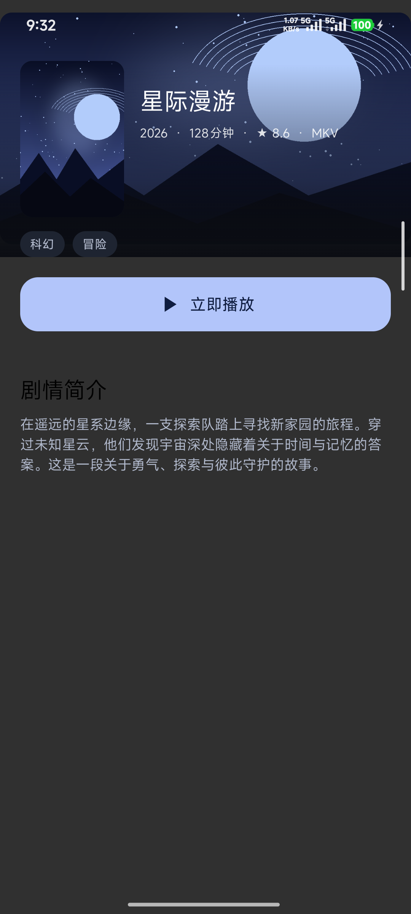

# MediaHub

> **你的媒体，尽在一处。**
>
> 为 Android 打造的多源媒体库与播放器。以克制的深色界面，连接你的媒体服务器、网络存储与本地内容。

[下载最新测试版 APK](https://github.com/fwzm/MediaHub/releases) · [浏览使用与开发文档](#文档) · [反馈问题](https://github.com/fwzm/MediaHub/issues)

[](https://github.com/fwzm/MediaHub/releases)
[](https://github.com/fwzm/MediaHub/releases)
[](LICENSE)

> **Alpha 测试阶段**：Release 当前仅提供 **arm64-v8a** APK，接口与体验仍可能调整。安装前需允许「安装未知应用」；同签名版本可覆盖升级。测试版不代表所有设备、服务端版本与媒体格式均已验证。

## 界面预览

<table>
  <tr>
    <td></td>
    <td></td>
  </tr>
  <tr>
    <td align="center"><sub>首页 · 媒体源与继续观看</sub></td>
    <td align="center"><sub>媒体库 · 海报、排序与筛选</sub></td>
  </tr>
  <tr>
    <td></td>
    <td></td>
  </tr>
  <tr>
    <td align="center"><sub>搜索 · 跨来源发现内容</sub></td>
    <td align="center"><sub>详情 · 作品信息与播放入口</sub></td>
  </tr>
</table>

<sub>截图来自 Android 上实际渲染的生产 Compose 组件，使用虚构片名与本地生成的艺术图；**不展示真实账号、真实服务器或真实媒体库内容**。</sub>

## 从浏览到播放

- **连接你的内容**：接入 Emby、Jellyfin、WebDAV 与本地存储，以统一的媒体模型浏览不同来源；实际能力以各 Provider 声明为准。
- **双内核播放**：Media3 / ExoPlayer 与 mpv 共用播放接口；AUTO 模式根据媒体特征与历史兼容结果选择引擎，并在支持的失败场景中尝试切换。也可在设置中手动指定。
- **沉浸式媒体库**：海报墙、背景图、详情页、收藏、排序与筛选；聚合搜索带来源标注，同作品可按已识别身份汇集多个来源。
- **接着看，按你的方式看**：本地续播与已接入服务端的进度回写、音轨与字幕选择、字幕样式、倍速、拖动定位与双击/长按手势。
- **为画面增添氛围**：播放器提供可配置的视觉效果与基于 artwork 的配色；效果可用性取决于系统版本、渲染能力与设置。
- **掌握自己的数据**：密码保护的本地备份支持预览后合并或替换恢复；备份不包含密码、Token 等登录凭据。来源同步提供导入预览与显式确认流程，**不宣称已完成真实双设备同步验收**。

## 设计语言

以「暗场影院」为方向，让内容成为视觉中心：

- **深色蓝靛色板**：低亮度背景、分层表面与克制的强调色，保持文字和控件层次清晰。
- **一致的形状与排版**：共享圆角、间距、标题与正文层级，减少页面间的视觉跳变。
- **共享组件**：卡片、分区标题、标签，以及加载、空内容、错误与重试状态采用一致表达。
- **Artwork 优先**：统一 2:3 海报、16:9 缩略图与详情背景图，并提供一致的加载和失败占位。
- **从浏览延续到播放**：共享配色、状态与视觉语言；播放器效果独立配置，不干扰核心操作。

## 项目状态

**当前界面美化代码只存在于 `feature/cinematic-ui` 分支，尚未合并进 `main`，也尚未形成独立 UI PR。**

该分支基于未合并的 [Draft PR #59](https://github.com/fwzm/MediaHub/pull/59)（基线 `c18f6a61`）。PR #59 的既有能力与本分支的界面改动都不应被理解为已进入 `main`；功能与验证结论以对应 PR 的最新记录为准。

<!-- MEDIAHUB:RECENT:START -->
## 最近更新

<sub>本区块由 scripts/github-nightly-sync.ps1 自动维护：每次同步时刷新近 7 天提交（最多 10 条）。</sub>

- 2026-10-14 feat(network): M0-A 闭环 — 加载/删除/并发边界 + 自定义 UA 设置界面（ADR-045）
- 2026-10-14 feat(network): 按服务器自定义 UA 持久化与身份代际清理（M0-A 闭环，ADR-045）
- 2026-10-14 docs(adr): ADR-045 服务器请求治理阶段一（UA 作用域与重定向边界）
- 2026-10-14 feat(network): 统一 UA 策略与逐跳 UA 注入（M0-A，ADR-045）
- 2026-10-14 Merge pull request #27 from fwzm/docs/a4-convergence-closeout-2026-10-14
- 2026-10-14 docs: A4 收敛闭环记录 — 合并证据、门禁计数与遗留项（2026-10-14）
- 2026-10-14 Merge pull request #24 from fwzm/a/joint-candidate-a4
- 2026-10-14 merge: integrate Agent B A4 convergence candidate 22e424d (33 commits)
- 2026-10-14 Merge pull request #26 from fwzm/codex/pr18-review-docs-20260930
<!-- MEDIAHUB:RECENT:END -->

## 模块结构

```text
app/                  应用壳、导航、依赖注入与全局主题
core/
  model/              统一媒体领域模型
  ui/                 共享 artwork、卡片、状态组件与播放器视觉效果
  network/            API、媒体网络与请求安全边界
  database/           Room、DataStore 与本地仓库
  security/           Android Keystore 加密存储与 Token 管理
  common/ logging/    通用能力、结构化日志与脱敏
player/
  engine/             Media3 / ExoPlayer 引擎
  mpv/                mpv 引擎与播放兼容路径
  compatibility/      设备能力与播放兼容评估
provider/
  api/ base/          Provider 契约、能力声明与注册
  emby/ jellyfin/ webdav/ local/
metadata/             元数据抽象
feature/
  home/ library/ search/ detail/ player/ server/ settings/
```

各数据源通过 `MediaProvider` 能力接口接入，UI 消费统一领域模型，不直接依赖服务端协议。架构说明见 [ARCHITECTURE.md](ARCHITECTURE.md)，重要取舍见 [DECISIONS.md](DECISIONS.md)。

## 从源码构建

需要 **JDK 21**、Android SDK（**compileSdk 36**，minSdk 26）和仓库内 Gradle Wrapper。Windows PowerShell 示例：

```powershell
$env:JAVA_HOME = 'C:\Program Files\Java\jdk-21'
# 通过 local.properties 的 sdk.dir 或 ANDROID_HOME 配置 Android SDK

.\gradlew.bat assembleDebug --no-daemon --console=plain --no-parallel --max-workers=1
.\gradlew.bat testDebugUnitTest :core:model:test :provider:api:test :metadata:test `
  --no-daemon --console=plain --no-parallel --max-workers=1
.\gradlew.bat lintDebug --no-daemon --console=plain --no-parallel --max-workers=1
```

Debug APK 输出至 `app/build/outputs/apk/debug/app-debug.apk`。构建命令不代表测试已经执行或通过；结果请查看对应 PR 与 CI 记录。

## 支持边界

- 当前是 Android Alpha 项目，不是稳定版；Release APK 仅面向 arm64-v8a，其他架构请自行评估源码构建。
- Emby、Jellyfin、WebDAV 与本地源的支持范围并不相同；聚合、收藏、进度、详情与播放能力取决于具体 Provider 和服务端响应。
- 播放以已实现的 Direct Stream / 直连路径与双内核能力为基础，**不等同于通用转码服务或任意格式保证**。设备、解码器、字幕和特效表现可能存在差异。
- 本地备份与恢复不等同于云备份；跨端来源同步、传输及真实双设备场景不应仅凭代码或回环测试视为已验收。
- 真机、真实服务端版本、旧数据库升级和跨设备矩阵的覆盖范围，以 [ROADMAP.md](ROADMAP.md)、[TASKS.md](TASKS.md)、[Provider 文档](docs/providers/README.md) 及 PR 验证记录为准。

## Windows 客户端

本分支包含 `windows/` 下的 Windows 原生客户端代码（C# / .NET 10、WinUI 3、libmpv），但它**尚未发布，也没有可下载安装包**。Windows 与 Android 独立构建，不共享运行时。

当前生产 libmpv 基线涉及 GPL 许可约束，在引擎切换与合规判定完成前不具备分发条件。构建方式、能力边界和第三方许可请直接查阅 [windows/README.md](windows/README.md)、[能力清单](windows/docs/CAPABILITY-MAP.md) 与 [第三方声明](windows/THIRD-PARTY-NOTICES.md)。

## 安全与隐私

- 不在源码中硬编码 Token、Cookie 或密码；敏感凭据由 `core:security` 使用 Android Keystore 加密存储。
- Token 通过请求头发送，不写入媒体 URL；临时播放 URL 不落库。
- 跨 origin 重定向按边界剥离凭据；日志经过脱敏处理。
- 本地备份不包含登录凭据。请妥善保管备份密码，遗忘后无法恢复加密备份。
- 不要在 Issue、日志或截图中公开真实账号、服务器地址、Token、Cookie 或私人媒体信息。

发现安全问题时，请先避免公开敏感细节，并通过 [GitHub Security Advisories](https://github.com/fwzm/MediaHub/security/advisories/new) 私下报告；无法使用该入口时，可在 Issue 中仅说明需要安全联系，不要附凭据或漏洞利用细节。

## 参与贡献

欢迎提交 Issue、文档修正与聚焦的 Pull Request。建议先阅读 [ARCHITECTURE.md](ARCHITECTURE.md)、[DECISIONS.md](DECISIONS.md) 和相关 Provider / Player 文档，再讨论较大改动。

提交前请运行与改动对应的构建和测试，保留真实失败记录，并在 PR 中说明实际验证范围；不要把编译通过、单元测试或模拟环境结果表述为真机/真实双设备验收。UI 改动请同时检查加载、空内容、错误状态与不同屏幕尺寸，截图须使用可公开的原创或本地演示素材。

## 文档

- [架构设计](ARCHITECTURE.md) · [架构决策](DECISIONS.md)
- [路线图](ROADMAP.md) · [任务与支持现状](TASKS.md)
- [Provider 文档](docs/providers/README.md) · [播放器文档](docs/player/README.md)
- [变更记录](CHANGELOG.md) · [开源许可](LICENSE)
